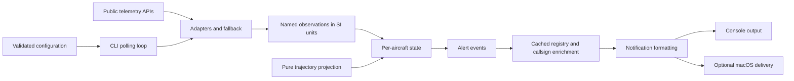

# Architecture

Aero Watch is a synchronous CLI. It polls a geographic surveillance box around
a target zone, normalizes provider observations into SI units, and processes
position changes. Only aircraft that produce alerts receive optional enrichment.

## Module boundaries

| Module | Owns | Does not own |
| --- | --- | --- |
| `models.py` | Immutable observations, bounds, and events | Provider schemas |
| `config.py` | Defaults, JSON loading, validation | Secrets or HTTP calls |
| `providers.py` | Telemetry normalization, ordered fallback, OAuth, cooldowns | Alert decisions |
| `prediction.py` | Local ray/box projection and compass headings | Observed entry/exit |
| `tracker.py` | Visits, ground transitions, warning deduplication, expiry | I/O or enrichment |
| `metadata.py` | Registry and callsign lookups, expiring caches | Whether to alert |
| `notifications.py` | Units, presentation, console and desktop delivery | Tracking state |
| `cli.py` | Arguments, polling, shutdown, and demo orchestration | Provider parsing |

## Observations and alerts

Missing telemetry stays unknown. A missing heading never becomes north, and a
missing speed never becomes stationary. Invalid records and stale positions are
skipped without discarding valid neighboring records. Bounds are inclusive.

`FlightTracker.process(observations, now)` receives a monotonic timestamp and
returns events. Actual entry and exit use positions, independently of prediction.
Ground-to-air evidence is required for takeoff; an initially climbing aircraft
produces an overhead alert. Departure settings govern both takeoff and exit.
Ground filtering affects notifications, preserving observations needed for
takeoff detection. Ground-only visits do not create airborne departure alerts.

Incoming warnings are limited by the configured lead time. A warning suppresses
the redundant overhead alert for that visit. Confirmed exits clear visit flags;
abandoned approaches can warn again. Missing observations do not prove an exit.
State expires after 600 seconds without a valid observation.

## Network and cache behavior

Providers are tried in order: adsb.lol, adsb.fi v3, OpenSky. A successful empty
scan ends fallback. This differs from the earlier edition, which polled and
merged all three feeds. Failures are logged separately from aircraft counts.
Rate-limited providers wait for Retry-After, or 60 seconds if it is invalid or
missing. Failed scans do not cause departure events.

Aircraft identity uses a 3,600-second cache; callsign routes and failed/incomplete
lookups use 300 seconds. A route key includes ICAO and callsign. Live identity
fields take precedence over registry fields; sparse refreshes preserve known
identity. Registry lookup may still be needed for an operator missing from live
telemetry. Routes are optional callsign associations, not verified itineraries.

Each request has finite connect/read timeouts. Enrichment happens synchronously
and can delay alert display when an uncached provider is slow. Poll intervals
are pauses after processing, not a guarantee of fixed scan frequency. Desktop
commands also have bounded waits and fall back to console output on failure.

## Reproducibility

The bundled demo uses synthetic aircraft, fixed timestamps, bundled HAL bounds,
and console delivery. It does not sleep, call APIs, enrich over HTTP, or show
desktop notifications. It deliberately uses default tracking behavior to show
all four events, even when the caller's live tracking settings suppress alerts.

Unit tests cover state, geometry, parsing, caches, settings, and notification
commands. A fixture-based integration test exercises provider → observation →
event → output. The wheel smoke check runs from outside the repo with networking
blocked during application commands, protecting package-resource and entry-point
behavior. CI checks Python 3.11 and 3.14; native desktop behavior still needs a
macOS visual and click check.
